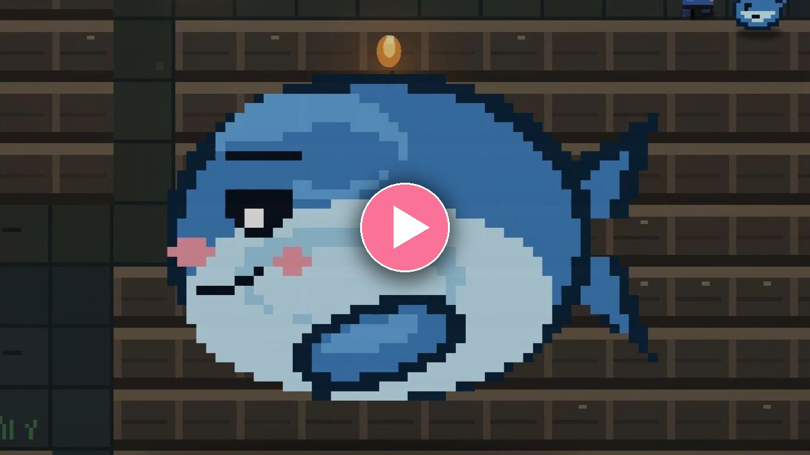
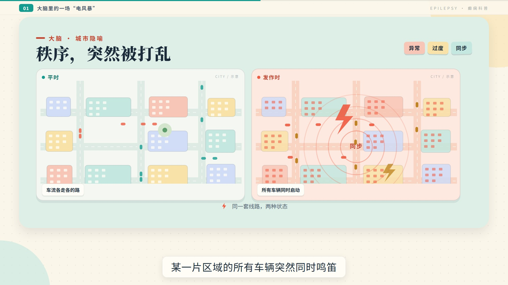

# AI 科普视频 · 工程合集

把"一个选题"做成"一支能看的科普片"，中间要经过：**文案 → 事实核查 → 配音 → 时间轴 → 画面 → 渲染 → 拼接 → QA → 交付**。

这个仓库收录这条流水线跑出来的每个主题：完整的工程源码、上游文案与考据、配音与时间轴脚本、逐版进度文档、验收数据。目标不是"放个成片"，而是任何人（或任何 AI）拿到仓库，都能看懂它怎么被做出来的，并且能重新渲染。

每个主题一个目录，互不影响；点进去有各自的 README。

---

## 主题 01 · RPG Maker：梦想与世界

[](topics/01-rpgmaker/README.md)

**15:52 · 1920×1080 / 30fps · Remotion + Blender Cycles + edge-tts**

讲 RPG Maker 从 1977 年 ASCII 创业到独立游戏时代的历史。这个主题迭代了三版：v1 旁白之间空转 330 秒、画面像按了暂停；v2 按语音实际长度重排时间轴、加全局运镜与两处 3D；v3 把 3D 挪到尾声、序章回到 v1。

- [工程与开发记录](topics/01-rpgmaker/README.md)
- [B 站发布版（11:51）](https://www.bilibili.com/video/BV1HvHN6gEZU)
- [成片下载（516 MB）](https://github.com/SkipTopic/ai-science-videos/releases/tag/film-v3)

---

## 主题 02 · 癫痫：大脑里的一场「电风暴」· 纯 MG 动画版

[](topics/02-epilepsy-mg/README.md)

**13:34 · 1920×1080 / 30fps · Remotion 纯代码绘制，无实拍 / 无 3D / 无患者影像**

医学科普。暖白纸面 + 大色块 + 矢量插画的 Motion Graphics 风格，十章一个主色。片中的 23 条医学说法逐条对过 WHO、ILAE、CDC、NHS 与中国癫痫指南，出处与"禁写清单"都在仓库里。

- [工程与开发记录](topics/02-epilepsy-mg/README.md)
- [成片下载（60 MB）](https://github.com/SkipTopic/ai-science-videos/releases/tag/epilepsy-mg)

---

## 结构

```
.
├─ README.md                 ← 你在这里（系列索引）
├─ LICENSE                   ← CC0 1.0，管作者原创部分
├─ NOTICE.md                 ← 使用范围 + 第三方素材 + 免责
└─ topics/
   ├─ 01-rpgmaker/           ← 主题一：工程 / 文档 / 文案 / 脚本 / 样片
   └─ 02-epilepsy-mg/        ← 主题二：工程 / 文档 / 文案 / 脚本 / 封面
```

每个主题目录内部基本同构：

```
<主题>/
├─ README.md      ← 成片参数、章节结构、复现步骤、已知取舍
├─ CREDITS.md     ← 素材与资料来源
├─ docs/          ← 交接报告、逐版进度、链接与依赖说明、QA 证据
├─ script/        ← 上游文案与考据资料（只读）
├─ code/          ← Remotion 工程（不含 node_modules / out）
├─ tools/         ← 配音、时间轴、渲染、QA 脚本
└─ preview/       ← 封面 / 样片 / 字幕
```

## 许可

**作者原创的部分（文案、代码、分镜、文档）：CC0 1.0。** 可复制、修改、二次创作、商用、再发布，不需要授权，也不需要署名——唯一要求是别用作者的名义给改过的东西背书。法律文本见 [`LICENSE`](LICENSE)。

**但仓库里混着别人的东西**：游戏截图、字体、3D 模型、引用的网页与文献、作品名称与商标，版权归各自权利人，**不在 CC0 范围内**。清权由使用方自负；若因这些第三方内容被投诉、下架或索赔，作者不承担任何责任。逐条清单与免责条款见 [`NOTICE.md`](NOTICE.md) 与各主题的 `CREDITS.md`。

一句话：**我的部分，拿走随便用；别人的部分，你自己搞定。**
